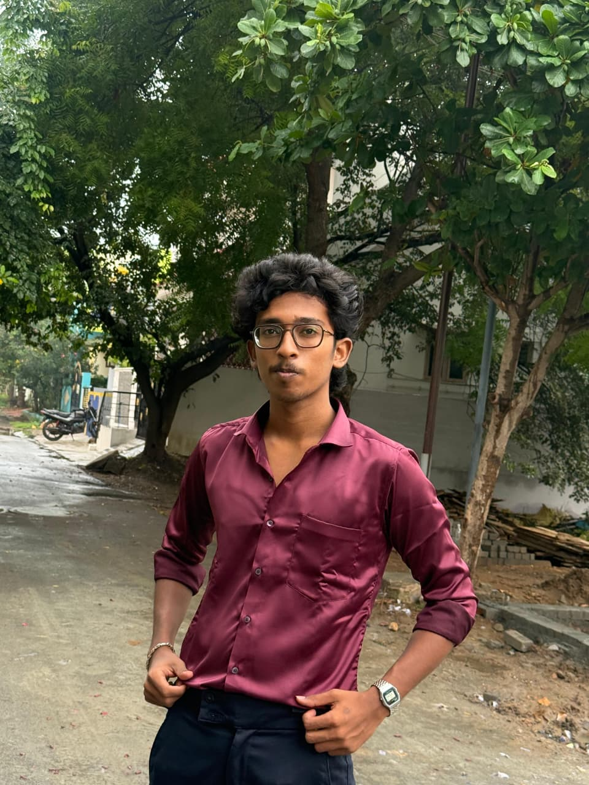

# Lohith Vel — Personal Portfolio Website ✦ Obsidian Luxury Edition

A high-performance personal portfolio engineered with pure Vanilla Web standards (HTML5, Vanilla CSS3, Modular JavaScript), featuring an elegant obsidian black classic aesthetic, 3D tilt physics, interactive particle starfield, and a fully functional developer terminal.



## ✦ Key Features

- **Obsidian Dark Classic Aesthetic**: Deep pitch-black surfaces with frosted glassmorphism (`backdrop-filter: blur(24px)`), specular light highlights, and ambient glow effects.
- **Dynamic Theme Engine**: 4 switchable obsidian accent themes:
  - 👑 *Champagne Gold* (Default)
  - ❄️ *Liquid Chrome Silver*
  - ⚡ *Cyber Emerald*
  - 🔮 *Royal Sapphire*
- **Interactive 3D Tilt Cards**: Real-time cursor-following perspective rotation with dynamic specular glare calculations.
- **Particle Starfield Background**: Lightweight HTML5 Canvas particle network reacting smoothly to cursor coordinates.
- **Interactive Developer Terminal**: Embedded interactive Unix shell supporting commands like `help`, `bio`, `skills`, `projects`, `contact`, `github`, `linkedin`, `matrix`, and `clear`.
- **Integrated Curriculum Vitae / Resume Viewer**: Interactive printable CV modal with print stylesheet formatting.
- **Synthesized Web Audio FX**: Optional soft micro-interaction audio chimes using pure browser Web Audio API oscillator synthesis (no external MP3/WAV files required).
- **Responsive Architecture**: Zero framework overhead, zero bundle step, 60 FPS silky smooth performance across desktop, tablet, and mobile.

## 🚀 Live Demo & Repository

- **GitHub Profile**: [github.com/lohithvelsakthi-arch](https://github.com/lohithvelsakthi-arch)
- **LinkedIn**: [linkedin.com/in/lohith-vel-a97024380/](https://www.linkedin.com/in/lohith-vel-a97024380/)

## 🛠️ Tech Stack

- **Markup**: Semantic HTML5 with complete OpenGraph SEO tags
- **Styling**: Pure Vanilla CSS3 with custom properties and keyframe physics
- **Logic**: Vanilla ES6+ JavaScript
- **Fonts**: Outfit, Plus Jakarta Sans, JetBrains Mono (via Google Fonts)

## 💻 Local Setup & Development

To run this portfolio locally without any build tools or dependencies:

```bash
# Clone the repository
git clone https://github.com/lohithvelsakthi-arch/portfolio.git

# Navigate into the project directory
cd portfolio

# Run with any static HTTP server (e.g. Python)
python -m http.server 8080
```

Open `http://localhost:8080/` in your browser.

## 📄 License

MIT License © 2026 [Lohith Vel](https://github.com/lohithvelsakthi-arch). All rights reserved.
